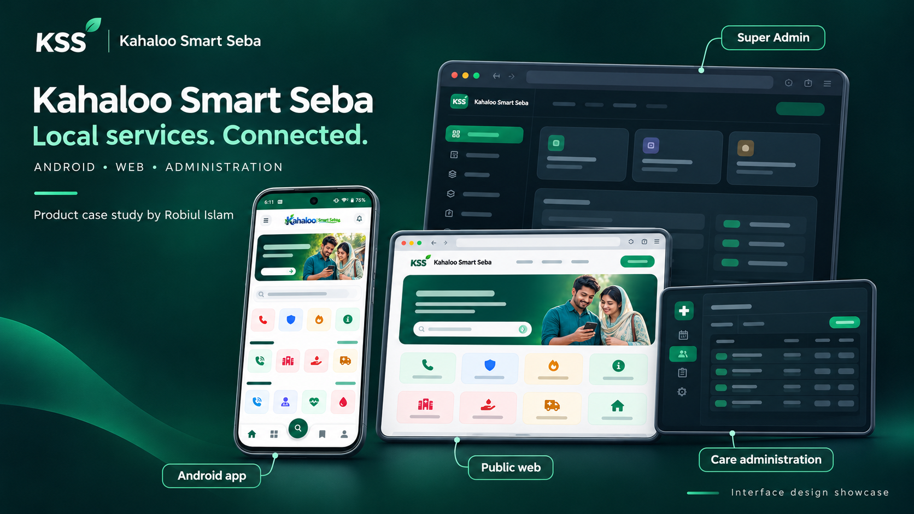
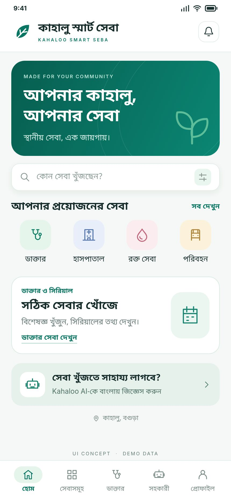
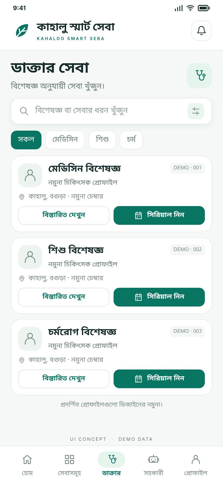
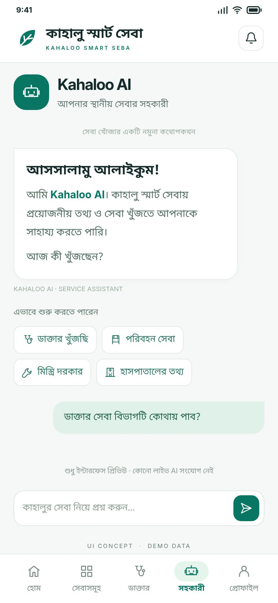
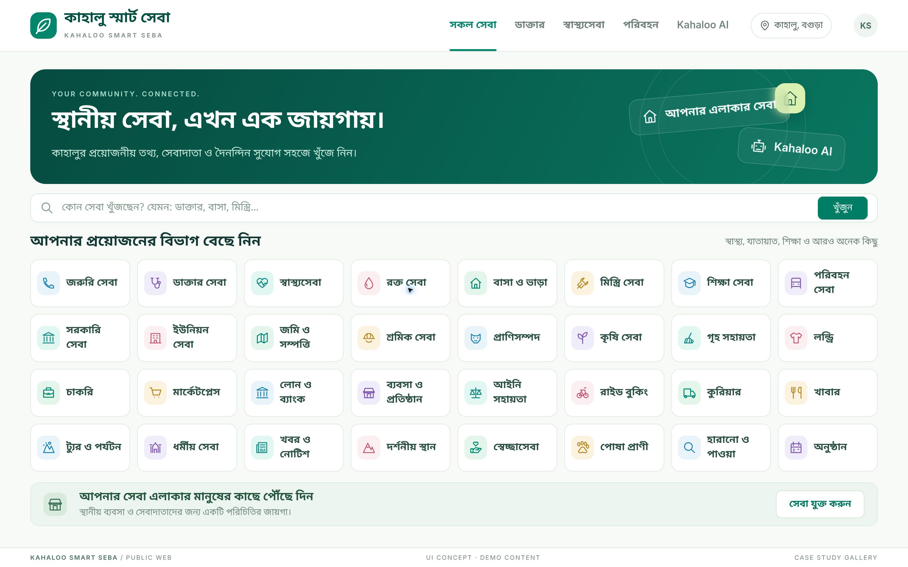
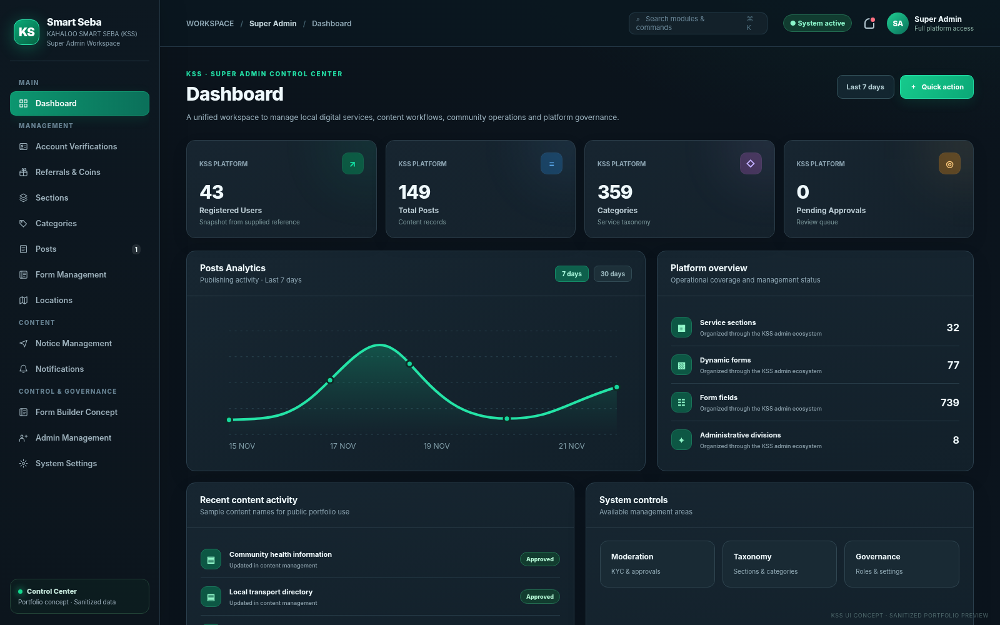
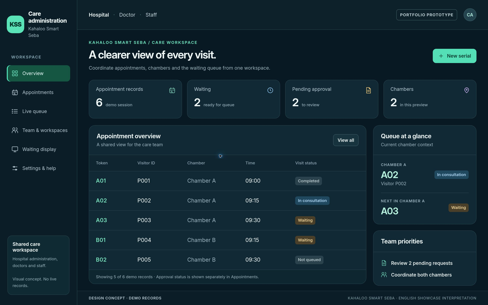

# Kahaloo Smart Seba

### Connecting local services through Android, web and coordinated administration

**Kahaloo Smart Seba (KSS)** is a hyperlocal digital services platform for Kahaloo, Bogura, Bangladesh. It brings healthcare information and appointment booking, local businesses, transport and everyday community services into one product.

I’m **Robiul Islam**, Founder & CEO and Full-Stack Developer of KSS. I lead product planning and hands-on development across the Android application, public website, backend, databases and administration tools. I also developed the Android app and managed its Google Play publishing workflow.

This repository documents the product, my contribution and its interface design. It contains public project documentation, curated screenshots and editable visual prototypes; the production application source remains private.

**Visuals:** 34 polished UI concepts based on screenshots of the existing product, with demonstration records. They present a proposed visual treatment rather than a deployed redesign. The [screen index](docs/SCREEN_INDEX.md) identifies views reconstructed from a reference and layouts developed from visible menu entries.

## Explore the product

| Surface | Primary users | Purpose |
| --- | --- | --- |
| Android app | Residents and people looking for services | Discover local information, find providers and access service workflows from a mobile device. |
| Public web application | Residents, visitors and service seekers | Access the platform and its service information through a browser. |
| Super Admin panel | Platform administrators | Coordinate platform content, service organisation and administrative operations. |
| Hospital, doctor and staff panel | Healthcare providers and their teams | Manage appointments and serials alongside relevant doctor and staff operations. |

[Interactive gallery](https://thisrobiul.github.io/kss-case-study/) · [View all screenshots](docs/SCREEN_INDEX.md) · [Four-part overview](assets/KSS_Interface_Overview.jpg)

| Collection | Images | Resolution |
| --- | ---: | --- |
| Android app | 6 | 860 × 1864 JPG |
| Public web | 9 | 2880 × 1800 JPG |
| Super Admin | 13 | 1600 × 1000 PNG |
| Care administration | 6 | 2880 × 1800 JPG |

The **interactive gallery** lives in `index.html`. To publish it, enable GitHub Pages from the `main` branch and `/(root)`; the gallery link above works once Pages is active. [বাংলা আপলোড নির্দেশনা](docs/UPLOAD_GUIDE_BN.md).

## The problem

Finding a doctor, locating a local technician, arranging transport or getting useful community information can involve several disconnected sources. A resident may know what they need without knowing which provider to contact or where to start.

KSS brings those entry points into a shared local platform. The product combines information discovery with service workflows, while giving the people operating those services separate administrative interfaces. The aim is to make local services easier to find and coordinate.

## Product scope

### Healthcare and appointments

The platform includes doctor appointment and serial booking, hospital and pharmacy information, blood donation information and emergency contacts. Dedicated doctor and hospital panels support the people managing the service side of those interactions.

Healthcare workflows focus on finding services, requesting appointments and coordinating serials.

### Transport and everyday services

KSS includes vehicle and rider booking, access to local technicians and home services. The wider platform brings together marketplace, food and grocery delivery, and courier or delivery service areas.

Community information also spans education and tutors, jobs, rentals, legal support, agriculture, livestock, domestic help and laundry. These areas share the same product context, while their individual service requirements differ.

### Discovery and assistance

Searchable service information, Google Maps and location features help users find relevant options. A support chatbot provides another entry point for assistance. Prayer-time information adds a practical everyday utility alongside the platform’s other local information.

## Interface showcase

### Android application

  
  
  

The mobile experience puts service discovery and access to frequently used functions close to the user. The showcase covers the service hub and related public-facing flows, including account access, assistance and healthcare discovery.

### Public web application

The web experience makes the product accessible in a browser. Its presentation groups the broad range of local services into readable sections so visitors can understand the platform and move toward a relevant service.

### Super Admin panel

The Super Admin surface provides a central place to organise the platform. The supplied reference screens cover areas such as categories, sections, locations, forms, posts, notices, account verification, referrals, administrators, settings and notifications.

The showcase emphasises a consistent navigation structure and clear management views. Any additional design exploration, such as a proposed form-builder layout, is identified in the screen index.

### Hospital, doctor and staff panel

The healthcare administration surface supports doctors and staff who manage appointment and serial operations. Separating this workspace from the public app gives service teams a focused interface for their own responsibilities.

The dashboard and appointment presentation are grounded in the supplied captures. Queue, team, waiting-display and settings layouts develop the menu entries into focused design concepts.

## My contribution

- Defined the product structure around local needs and organised the service areas into a shared platform.
- Developed the Android application and public web application.
- Built the PHP-based web and administration interfaces, with CSS styling and SQL-based data systems.
- Worked on backend, database and application integration across the product.
- Implemented appointment/serial booking and other service workflows, including transport and provider access.
- Integrated APIs, Google Maps/location features, the support chatbot and prayer-time information.
- Built dedicated administration interfaces for platform operations and healthcare service teams.
- Managed testing, troubleshooting, publishing requirements and Google Play release workflows.
- Continued refining the product and coordinating how its services are presented and managed.

## Technical foundation

The following reflects the technology and implementation areas documented for KSS.

| Area | Documented foundation |
| --- | --- |
| Client surfaces | Android application and public web application |
| Web and administration | PHP and CSS |
| Data | SQL-based database work and application/database integration |
| Integrations | APIs, Google Maps/location features, support chatbot and prayer-time information |
| Operations | Super Admin and healthcare administration interfaces |
| Android release work | Google Play Console and publishing/release workflows |

The included showcase source uses self-contained HTML, CSS and JavaScript for presentation. It is separate from the production application.

## Product and design considerations

**Breadth needs clear organisation.** A platform covering many local service areas must help users choose a useful starting point. The visual direction groups related services, establishes consistent page structure and gives primary actions appropriate emphasis.

**Different roles need different workspaces.** Residents, platform administrators and healthcare teams have different tasks. The four product surfaces let the case study explain those responsibilities without presenting every control to every audience.

**A booking spans more than one screen.** Service discovery, a user’s request and provider-side coordination belong to the same product journey. The showcase presents both the public and administrative sides so that relationship is visible.

**Product evidence and design exploration serve different purposes.** The original screenshots informed this presentation. The redesigned UI expresses a proposed visual treatment. Where a screen introduces a concept-specific control or sample state, its caption identifies that distinction.

## Results and continuing work

The project brings together the Android and web applications, a central administration panel and a dedicated healthcare operations panel. This case study records that scope and presents the work as one connected product.

The work demonstrates product planning and development across public and administrative experiences, with a consistent way to organise a broad local service directory.

## Links

- [Kahaloo Smart Seba website](https://kahaloosmartseba.com/)
- [Google Play listing](https://play.google.com/store/apps/details?id=com.shebayan.kahaloosmartseba)
- [Shebayan technology](https://shebayantechnology.com/)
- [Robiul Islam’s portfolio](https://thisrobiul.github.io/portfolio/)
- [GitHub profile](https://github.com/ThisRobiul)

---

**Built and documented by Robiul Islam.** Public project documentation and UI presentation; proprietary application source is excluded.

<!-- Trigger GitHub Pages deployment -->
