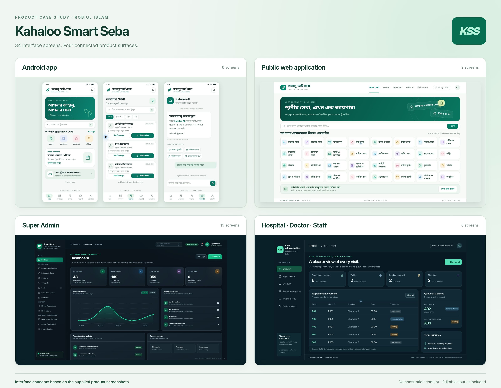

# KSS — Screen Index

34 interface concepts based on Robiul Islam’s supplied product captures. Original reference captures remain outside this public package. All records shown in the visual concepts are sample or reference-snapshot values.

The image links open the full-resolution JPG or PNG. Editable views provide local presentation controls and navigation.

## Android app — 6 screens

| Screen | Full image | Editable view | Caption |
| --- | --- | --- | --- |
| Service hub | [Open](../screens/android/android-01-home.jpg) | [View](../prototypes/android/index.html?screen=home) | Service discovery with search, featured categories and common local services. |
| All services | [Open](../screens/android/android-02-services.jpg) | [View](../prototypes/android/index.html?screen=services) | A readable directory of local service categories. |
| Doctors & serials | [Open](../screens/android/android-03-doctors.jpg) | [View](../prototypes/android/index.html?screen=doctors) | Specialty discovery and appointment entry points, using demo provider records. |
| Kahaloo AI | [Open](../screens/android/android-04-assistant.jpg) | [View](../prototypes/android/index.html?screen=assistant) | A service-assistance conversation concept based on the supplied chat screen. |
| Account overview | [Open](../screens/android/android-05-profile.jpg) | [View](../prototypes/android/index.html?screen=profile) | A sample account view with service requests and account actions. |
| Sign in | [Open](../screens/android/android-06-signin.jpg) | [View](../prototypes/android/index.html?screen=signin) | An account-access presentation with no live authentication connection. |

## Public web — 9 screens

| Screen | Full image | Editable view | Caption |
| --- | --- | --- | --- |
| Public service directory | [Open](../screens/web/web-01-home.jpg) | [View](../prototypes/web/index.html?screen=home) | The public website unifies local service discovery. |
| Kahaloo AI on web | [Open](../screens/web/web-02-assistant.jpg) | [View](../prototypes/web/index.html?screen=assistant) | A browser-based service-assistance interface. |
| Doctor services | [Open](../screens/web/web-03-doctors.jpg) | [View](../prototypes/web/index.html?screen=doctors) | Specialty navigation and sample service-provider cards. |
| Healthcare overview | [Open](../screens/web/web-04-healthcare.jpg) | [View](../prototypes/web/index.html?screen=healthcare) | Healthcare categories and service entry points. |
| Healthcare categories | [Open](../screens/web/web-05-healthcare-categories.jpg) | [View](../prototypes/web/index.html?screen=healthcare-categories) | A focused directory for health service categories. |
| Blood donation directory | [Open](../screens/web/web-06-blood.jpg) | [View](../prototypes/web/index.html?screen=blood) | Blood-group discovery with anonymous demonstration records. |
| Local technicians | [Open](../screens/web/web-07-technicians.jpg) | [View](../prototypes/web/index.html?screen=technicians) | Trades and home-service categories. |
| Education services | [Open](../screens/web/web-08-education.jpg) | [View](../prototypes/web/index.html?screen=education) | Education and tutoring service categories. |
| Transport services | [Open](../screens/web/web-09-transport.jpg) | [View](../prototypes/web/index.html?screen=transport) | Vehicle and local transport service categories. |

## Super Admin — 13 screens

The Form Builder view is an additional design exploration. Other views organise modules shown in the original Super Admin references. The overview chart and values are presentation content, not current performance measurements.

| Screen | Full image | Editable view | Caption |
| --- | --- | --- | --- |
| Platform dashboard | [Open](../screens/super-admin/super-admin-01-dashboard-overview.png) | [View](../prototypes/super-admin/index.html#dashboard) | Overview with values reproduced or illustrated from the original reference; no live analytics. |
| Account verifications | [Open](../screens/super-admin/super-admin-02-account-verifications-kyc.png) | [View](../prototypes/super-admin/index.html#verifications) | Account review and verification concept. |
| Notice management | [Open](../screens/super-admin/super-admin-03-notice-management.png) | [View](../prototypes/super-admin/index.html#notices) | Community notice publishing and organisation. |
| Category management | [Open](../screens/super-admin/super-admin-04-categories-management.png) | [View](../prototypes/super-admin/index.html#categories) | Service taxonomy management. |
| Referrals & coins | [Open](../screens/super-admin/super-admin-05-referrals-and-coins.png) | [View](../prototypes/super-admin/index.html#referrals) | Referral administration concept. |
| Post management | [Open](../screens/super-admin/super-admin-06-posts-management.png) | [View](../prototypes/super-admin/index.html#posts) | Content review and organisation. |
| Section management | [Open](../screens/super-admin/super-admin-07-sections-management.png) | [View](../prototypes/super-admin/index.html#sections) | Top-level service organisation. |
| Location management | [Open](../screens/super-admin/super-admin-08-locations-management.png) | [View](../prototypes/super-admin/index.html#locations) | Geographic service organisation. |
| Form management | [Open](../screens/super-admin/super-admin-09-form-management.png) | [View](../prototypes/super-admin/index.html#forms) | Service-specific form administration. |
| Proposed form builder | [Open](../screens/super-admin/super-admin-10-dynamic-form-builder-concept.png) | [View](../prototypes/super-admin/index.html#form-builder) | Additional design exploration; a complete form editor was not demonstrated in the sources. |
| Administrator management | [Open](../screens/super-admin/super-admin-11-admin-management.png) | [View](../prototypes/super-admin/index.html#admins) | Administrative account management concept. |
| System settings | [Open](../screens/super-admin/super-admin-12-system-settings.png) | [View](../prototypes/super-admin/index.html#settings) | System-setting presentation. |
| Notifications | [Open](../screens/super-admin/super-admin-13-notifications.png) | [View](../prototypes/super-admin/index.html#notifications) | Notification management concept. |

## Hospital / doctor / staff — 6 screens

The original six captures show a dashboard, an appointment table and overlapping navigation areas. Queue, team, TV and settings detail layouts are proposed interpretations of those navigation entries.

| Screen | Full image | Editable view | Caption |
| --- | --- | --- | --- |
| Care operations overview | [Open](../screens/hospital/hospital-01-dashboard.jpg) | [View](../prototypes/hospital/index.html?screen=dashboard) | A focused dashboard for appointments and queue coordination. |
| Appointment management | [Open](../screens/hospital/hospital-02-appointments.jpg) | [View](../prototypes/hospital/index.html?screen=appointments) | Sample tokens, chamber, visit state and approval state. |
| Live queue concept | [Open](../screens/hospital/hospital-03-queue.jpg) | [View](../prototypes/hospital/index.html?screen=queue) | An illustrative presentation of waiting, consultation and completion. |
| Doctor & staff workspace | [Open](../screens/hospital/hospital-04-team.jpg) | [View](../prototypes/hospital/index.html?screen=team) | A proposed team view based on navigation visible in the reference. |
| Waiting-room display concept | [Open](../screens/hospital/hospital-05-tv.jpg) | [View](../prototypes/hospital/index.html?screen=tv) | A proposed display layout based on the TV Display menu entry. |
| Chamber settings concept | [Open](../screens/hospital/hospital-06-settings.jpg) | [View](../prototypes/hospital/index.html?screen=settings) | A proposed settings layout using neutral sample content. |

## Cover and overview

- [Project cover](../assets/kss-project-cover.png): AI-generated editorial product illustration.
- [Four-part overview](../assets/KSS_Interface_Overview.jpg): composed from the actual showcase exports.

## Design sources

- Original user-supplied captures: 13 Super Admin, 6 healthcare administration, 9 Android and 9 public web screenshots.
- Public-screen styling: Bengali typography, teal/emerald actions, pale service-category tiles.
- Operational styling: dark navy backgrounds, emerald highlights and focused management views.
- Local fonts: Inter and Noto Sans Bengali; bundled license notices are alongside the font files.
